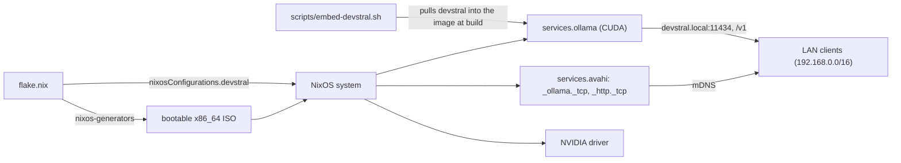
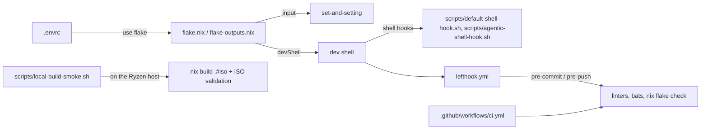

# nixos-ollama-devstral-cuda

<!-- hallucinogen:autonomy-disclaimer start -->
> Read [LLM-DISCLAIMER](docs/LLM-DISCLAIMER.md) first. This repository is
> tended by an autonomous loop, and that file says what the loop may do here,
> what it may not, and what to check before trusting anything in this tree.
<!-- hallucinogen:autonomy-disclaimer end -->

[](https://github.com/pr0d1r2/nixos-ollama-devstral-cuda/actions/workflows/ci.yml) [](LICENSE) [](https://nixos.org)

## What it is

This flake builds a bootable x86_64 NixOS ISO appliance with Ollama,
Devstral, CUDA support, and Avahi service discovery. The ISO is intended to
be built and booted on the Ryzen/NVIDIA target host itself. The model and
runtime are embedded in the image, so the appliance does not need to pull the
model after boot.

## Architecture



## Usage

Build the ISO natively on the Ryzen x86_64-linux host:

```sh
nix build .#iso
```

Run the local smoke, including `nix flake check` and validation of the ISO
artifact:

```sh
./scripts/local-build-smoke.sh
```

The command leaves the generated artifact under `result/` (the ISO filename
is provided by `nixos-generators`). This build is intentionally not part of
the lightweight GitHub Actions checks, and the aarch64-darwin Mac is not a
supported ISO build host.

To write the ISO to a USB drive, stay on the same Ryzen host and follow
[the USB delivery procedure](docs/DELIVERY.md). It verifies the target disk
before using `dd`; there is no Mac roundtrip.

After booting the USB, follow the [boot smoke procedure](docs/BOOT-SMOKE.md)
to verify Ollama, Devstral, Avahi/mDNS, NVIDIA GPU offload, and the LAN bind.

The appliance serves Ollama on `devstral.local:11434` and publishes the
`_ollama._tcp` and `_http._tcp` Avahi services. The firewall permits Ollama
and mDNS only from the trusted `192.168.0.0/16` LAN subnet.

### LAN coding-agent target

OpenAI-compatible clients should use the appliance's `/v1` base URL, the
`devstral` model, and the dummy API key `ollama`:

```text
base URL: http://devstral.local:11434/v1
model: devstral
API key: ollama
```

Verify the OpenAI-compatible model listing from a LAN peer:

```sh
curl --fail --silent --show-error \
  http://devstral.local:11434/v1/models
```

The response must list `devstral` (or `devstral:latest`). For recent Ollama
Codex integrations, set `wire_api = "responses"`. Do not use Codex `--oss`:
that option targets a local Ollama instance and bypasses this LAN appliance.

__Security warning:__ Ollama on port 11434 has no authentication and no TLS.
Connect the appliance only to a trusted, isolated LAN. Do not expose port
11434 (or the appliance) directly to the internet or an untrusted network.

## Development architecture



## License

Licensed under the MIT License. See [LICENSE](LICENSE).
